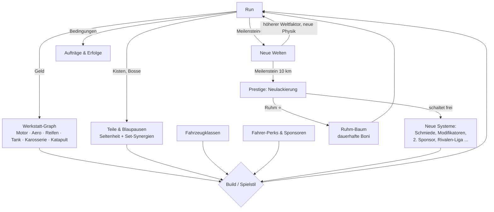

# Game-Design-Dokument – Arbeitstitel „SCHLEUDERWERK“

> Version 0.2 · Stand 13.10.2026 · Status: **bestätigt** (Titel „Schleuderwerk“, 2,5D, Schleuder-Abschuss, Wischen & Halten, Zielgerät Pixel 8 Pro)
> Alle Zahlen sind Startwerte und landen später 1:1 in Konfigurationsdateien (`src/config/*.js`).

---

## 1. Kurzbeschreibung

Ein Low-Poly-Auto wird mit einem riesigen Katapult abgeschossen. Im Flug steuert der Spieler Neigung und Boost, sammelt Münzen, fliegt durch Ringe, macht Saltos und versucht, sauber auf den Rädern zu landen, um weiterzurollen. Mit dem verdienten Geld baut er sein Auto in einer Werkstatt aus, schaltet neue Fahrzeuge, Teile, Fahrer und Welten frei und setzt irgendwann per Prestige zurück, um neue Systeme zu erhalten.

**Darstellung: 2,5D.** Die Welt ist echtes 3D (Low-Poly, Licht, Schatten, Tiefe), das Auto bewegt sich aber nur auf einer Ebene (Distanz × Höhe) und dreht sich um eine Achse. Die Kamera schaut schräg von der Seite.
*Warum:* Die Steuerung mit einer Hand bleibt so klar, die selbst geschriebene Physik bleibt stabil und vorhersehbar, und das Spiel läuft auch auf Mittelklasse-Handys flüssig.

---

## 2. Kern-Loop

```
┌────────────┐   ┌─────────────┐   ┌───────────────────┐   ┌──────────────┐
│ VORBEREITEN│──▶│  ABSCHUSS   │──▶│ FLUG & FAHRT      │──▶│ LANDUNG/ENDE │
│ Auto, Teile│   │ Winkel+Kraft│   │ Neigen, Boost,    │   │ Auswertung,  │
│ Items,     │   │ per Timing  │   │ Ringe, Tricks,    │   │ Rekorde,     │
│ Sponsor    │   │ (Perfekt!)  │   │ Kombos, Gefahren  │   │ Belohnungen  │
└─────▲──────┘   └─────────────┘   └───────────────────┘   └──────┬───────┘
      │                                                          │
      │            ┌────────────────────────────────┐            │
      └────────────│ WERKSTATT: Upgrades, Teile,    │◀───────────┘
                   │ Aufträge, Welten, Prestige     │
                   └────────────────────────────────┘
```

Ein Run dauert 30–90 Sekunden. Vom Ende eines Runs bis zum nächsten Abschuss sind es höchstens zwei Tipps („Werkstatt“ → „Starten“), damit der Spielfluss erhalten bleibt.

### 2.1 Abschuss: Schleuder (ca. 3 s) ✅ *bestätigt*
- Finger irgendwo aufs Display legen, **nach hinten ziehen** und **loslassen**. Der Ziehweg bestimmt die Kraft, die Zugrichtung den Winkel (5°–80°). Das Auto wird in der Schleuder sichtbar zurückgezogen, eine gepunktete Linie zeigt den Anfang der Flugbahn.
- **Timing-Element:** Auf der Kraftanzeige wandert eine grüne Zone auf und ab. Wer loslässt, während die eigene Kraft in der Zone liegt, schafft einen **perfekten Abschuss**: +15 % Tempo, Zeitlupe und Kombo-Start. Volle Kraft *und* perfekt geht nur, wenn man im richtigen Moment loslässt.
- Später verbreitern Upgrades und Fahrer die grüne Zone.

### 2.2 Steuerung im Flug (eine Hand, Hochformat) ✅ *bestätigt: Wischen & Halten*
| Geste | Wirkung |
|---|---|
| **Wischen** links/rechts | dreht das Auto direkt mit dem Finger (rechts = Nase runter). Schnelles Wischen und Loslassen gibt Schwung für Saltos. |
| **Halten** (ab 0,18 s) | **BOOST** in Richtung der Motorhaube, verbraucht Energie. Während des Haltens kann weiter gedreht werden. |
| nichts berühren | Das Auto richtet sich langsam in Flugrichtung aus, Flügel erzeugen je nach Anstellwinkel Auftrieb. |

- **Bremsen/Gleiten** ergeben sich aus dem Winkel: Nase leicht hoch = Gleitflug (weit), Nase steil hoch = Luftbremse (Gefahren ausweichen), Nase runter = Sturzflug (Tempo aufbauen).
- **Spezialfähigkeit des Fahrzeugs** (später): Doppeltipp.

### 2.3 Landung und Bodenphase
- **Saubere Landung** (Räder unten, Winkel innerhalb der Toleranz): Das Tempo bleibt weitgehend erhalten und das Auto rollt weiter. Bonus.
- **Perfekte Landung** (< 8° Abweichung): großer Bonus, Kombo wird gesichert.
- **Bruchlandung** (Dach/Nase zuerst): starker Tempoverlust, Kombo bricht ab, Schaden (die Karosserie fängt Treffer ab).
- Am Boden: Hügel, Rampen und Sprungschanzen schleudern das Auto erneut in die Luft. Boost funktioniert auch am Boden.
- **Run-Ende:** wenn das Tempo am Boden unter 1 m/s fällt oder die Karosserie zerstört ist.

### 2.4 Kombos und Tricks
Jede Aktion erhöht den **Kombo-Multiplikator** um den angegebenen Wert. Er gilt für Trick-Punkte und eingesammelte Münzen des Runs.

| Trick | Bedingung | Kombo |
|---|---|---|
| Salto (vor/rück) | volle 360°-Drehung | +0,25 |
| Doppel-/Dreifachsalto | 720°/1080° ohne Bodenkontakt | +0,6 / +1,0 |
| Near-Miss | Hindernis/Gefahr in < 1,5 m passiert | +0,15 |
| Ring-Kette | 3 Boost-Ringe ohne Bodenkontakt | +0,3 |
| Saubere/Perfekte Landung | siehe oben | +0,1 / +0,3 |
| Höhenrausch | neue Run-Höhe über 100/250/500 m | +0,2 |
| Bruchlandung | – | Kombo wird auf ×1,0 zurückgesetzt |

Kombos laufen am Boden nach 3 s ohne Aktion aus. Dabei wird der aktuelle Stand **gesichert** (ausgezahlt), damit sich Risiko lohnt, aber nicht alles mit einem Fehler verloren ist.

### 2.5 Belohnung pro Run
```
Geld = (Distanz_m × 0,5 + MaxHöhe_m × 1,0 + Münzen + gesicherte Trickpunkte) × Weltfaktor × Ruhm-Bonus × Sponsor
gesicherte Trickpunkte = Σ (Punkte einer Kombo-Kette × Kombo-Multiplikator)
```
Münzen sind sofort sicher. Trickpunkte zählen erst, wenn die Kette gesichert ist (2,5 s am Boden ohne neue Aktion). Bei einem Unfall ist die laufende Kette verloren.
Dazu kommen gelegentlich **Kisten** (Teile) aus der Strecke, Bosse und Aufträge.

---

## 3. Progression (nicht linear)

### 3.1 Übersicht



### 3.2 Werkstatt-Graph (Währung: Geld 💰)
Sechs Äste, die von einem gemeinsamen Zentrum („Chassis“) ausgehen. Jeder Ast hat:
- **Stufen-Knoten** (z. B. „Motor-Schub 1–30“): kontinuierliche Verbesserung.
- **Meilenstein-Knoten** bei Stufe 5/15/25: neue Mechaniken (z. B. „Nachbrenner: Boost lädt bei Salto 10 % nach“).
- **Weggabelungen**: Man wählt 1 von 2 Knoten (z. B. *Leichtbau*: −15 % Gewicht ODER *Panzerung*: +2 Treffer). Umentscheiden ist jederzeit günstig möglich, damit Experimentieren nichts kostet.
- **Brückenknoten** zwischen benachbarten Ästen werden erst freigeschaltet, wenn beide Äste weit genug ausgebaut sind (z. B. Aero + Tank → „Ram-Air: Gleiten lädt Boost langsam auf“). Daraus entstehen Synergien.

| Ast | Kernwerte | Beispiel-Meilensteine |
|---|---|---|
| Katapult | Startkraft, Perfekt-Zone | „Doppelspannung“: zweiter Kraftbalken für Überladung |
| Motor | Boost-Schub, Drehgeschwindigkeit | „Nachbrenner“, „Turbo-Start“ |
| Aerodynamik | Luftwiderstand, Auftrieb | „Klappflügel“: Gleiten per Halten links+rechts |
| Reifen | Rollreibung, Landetoleranz, Federung | „Springfedern“: Landung → Mini-Hüpfer |
| Treibstoff | Energie, Regeneration, Effizienz | „Reservekanister“: 1× Notboost |
| Karosserie | Gewicht ↔ Panzerung, Rammen | „Rammbügel“: Hindernisse zerstören statt abprallen |

### 3.3 Teile (Währung: Blaupausen 📘 + Geld)
- Slots: **Motor, Flügel, Reifen, Tank, Spezialmodul** (später ein 2. Spezialslot).
- Seltenheit: Gewöhnlich (grau) · Selten (blau) · Episch (lila) · Legendär (gold). Höhere Seltenheit = mehr Zusatzeigenschaften.
- **Set-Synergien**, z. B.:
  - *Kolibri-Set* (2/3): Saltos geben +1 % Auftrieb pro Salto für den restlichen Run.
  - *Bulldozer-Set* (2/3): Jedes zerstörte Hindernis gibt 5 % Boost zurück.
  - *Thermik-Set* (2/3): Aufwinde wirken doppelt so stark.
- Spezialmodule verändern das Spiel spürbar: Raketenrucksack, Gleitschirm, Federbein (Wand-Hüpfer), Magnetspule, Ballon (Höhen-Build).
- Doppelte Teile werden zu Blaupausen zerlegt. Mit Blaupausen lassen sich gezielt Teile bauen (keine reine Zufallsjagd).

### 3.4 Fahrzeugklassen

| Fahrzeug | Gewicht | Luftwid. | Stärke | Schwäche | Spezialfähigkeit | Freischaltung |
|---|---|---|---|---|---|---|
| Kompakt „Floh“ | mittel | mittel | ausgewogen | – | Hüpfer (kleiner Sprung) | Start |
| Pickup „Ackergaul“ | schwer | hoch | rollt weit, robust | träge Drehung | Rammbock (durchbricht Hindernisse) | 1.500 m |
| Buggy „Grashüpfer“ | leicht | mittel | schnelle Saltos, federt | wenig Panzerung | Doppelsprung in der Luft | Wüste |
| Sportwagen „Pfeil“ | leicht | sehr niedrig | Topspeed, Boost | zerbrechlich, kurze Landetoleranz | Nitro-Stoß | Eis |
| Bus „Brummer“ | sehr schwer | sehr hoch | riesiger Tank, 5 Treffer | fliegt kaum | Schild-Aufprall | Stadt |
| Prototyp „Komet“ | mittel | niedrig | Flügel ab Werk | teure Upgrades | Gleitmodus | Prestige 2 |
| „Mondhüpfer“ | sehr leicht | – | Weltraum-Spezialist | am Boden schwach | Schwerkraft-Umkehr (kurz) | Weltraum |

Jedes Fahrzeug hat eigene Werkstatt-Stufen. Ein Teil der Upgrades (Katapult, Treibstoff-Effizienz) gilt global, damit ein Wechsel nie bei null beginnt.

### 3.5 Spezialisierungen / Builds
Builds sind keine Klassenwahl, sondern ergeben sich aus Fahrzeug, Graph, Teilen und Fahrer:

| Build | Typische Kombination | Spielgefühl |
|---|---|---|
| **Distanz-Raser** | Pfeil + Aero-Ast + Thermik-Set | flach und schnell, Gleitflug, lange Rollphasen |
| **Höhenjäger** | Floh/Komet + Ballon + Katapult-Ast | steil hoch, Höhenboni, Thermik reiten |
| **Trick-Künstler** | Grashüpfer + Motor-Drehung + Kolibri-Set | Saltos und Kombo-Ketten, hoher Multiplikator |
| **Tank** | Ackergaul/Brummer + Karosserie + Bulldozer | Hindernisse zerstören, Risiko-Zonen durchfahren |

### 3.6 Fahrer und Sponsoren
- **Fahrer** (1 aktiv, später 2): werden über Erfolge und Rivalen freigeschaltet. Beispiele:
  - *Oma Gerda*: Perfekt-Zone +30 %, aber −10 % Boost.
  - *Stuntman Kalle*: +0,1 Kombo pro Trick, Landetoleranz −3°.
  - *Professorin Volt*: Boost regeneriert beim Gleiten.
- **Sponsoren-Verträge** (1 Slot, nach Prestige 2): Vor dem Run wählbar, mit Bedingung und Bonus, z. B. „Turbo-Limo: 3 Saltos → +60 % Geld“ oder „Reifen-Rudi: kein Bruch → Kiste garantiert“. Wer die Bedingung verfehlt, verliert nur den Bonus, nie etwas anderes.

### 3.7 Welten

| # | Welt | Physik-Besonderheit | Gefahren/Objekte | Palette | Weltfaktor 💰 | Freischaltung |
|---|---|---|---|---|---|---|
| 1 | **Schrottplatz-Steppe** | Standard | Reifenstapel, Rampen, Boost-Ringe | Ocker, Rostrot, Himmelblau | ×1 | Start |
| 2 | **Glutwüste** | Thermik-Säulen (Aufwind) | Kakteen, Sandsturm, **Boss: Sandwurm** | Sand, Orange, Türkis | ×3 | 3,5 km Bestweite |
| 3 | **Frostgipfel** | Eis: kaum Rollreibung | Eiszapfen, Lawinen, **Boss: Gletscherwand** | Weiß, Eisblau, Violett | ×8 | 6 km |
| 4 | **Neonstadt** | Dächer als Rampen, Fahrtwind zwischen Häusern | Kräne, Drohnen, **Boss: Abrissbirne** | Nachtblau, Pink, Neongelb | ×20 | Prestige 1 |
| 5 | **Vulkaninsel** | Lava = Schaden, Eruptionen = Mega-Boost | Lavafontänen, Ascheregen, **Boss: Feuerberg** | Schwarz, Glutrot, Gold | ×60 | Prestige 2 |
| 6 | **Orbit** | niedrige Schwerkraft, Gravitationsfelder | Asteroiden, Satelliten, **Boss: Mutterschiff** | Tiefviolett, Cyan, Weiß | ×200 | Prestige 3 |

Jede Welt hat eigene Rekorde, einen eigenen Rivalen und 3 Herausforderungsstrecken.

### 3.8 Prestige: „Neulackierung“
- **Erstmals möglich** ab 10 km Weite in einem Run (Ziel: nach ca. 3–5 h).
- Zurückgesetzt werden: Geld, Werkstatt-Stufen. **Behalten** werden: Teile, Blaupausen, Fahrer, Erfolge, Welten-Zugang (ab Welt 4 wieder über Meilensteine) und Rekorde.
- Belohnung: **Ruhm ⭐** = `floor(10 × √(Gesamtverdienst dieses Durchgangs / 100.000))`.
- **Ruhm-Baum** (dauerhaft): +Geld %, Startkapital, Startstufen für Katapult, zusätzliche Item-Slots, bessere Kisten.
- **Jede Prestige-Stufe schaltet ein neues System frei**, damit sich ein Neustart durch neue Möglichkeiten lohnt und nicht nur durch größere Zahlen:

| Prestige | Neue Systeme |
|---|---|
| 1 | Neonstadt, **Run-Modifikatoren** (Risiko-Karten), Teile-Schmiede (Teile verbessern) |
| 2 | Vulkaninsel, Prototyp „Komet“, **Sponsoren**, 2. Fahrerslot |
| 3 | Orbit, **Rivalen-Liga**, 2. Spezialmodul-Slot |
| 4+ | „Meisterschaft“: Welt-Mutatoren (z. B. Spiegelstrecke, Nachtmodus), legendäre Sets, Endgame-Rekordjagd |

### 3.9 Ziele
- **Kurzfristig – Auftragsbrett:** 3 Aufträge gleichzeitig (z. B. „Fliege durch 10 Ringe“, „Lande perfekt mit dem Pickup“). Ein erledigter Auftrag wird sofort durch einen neuen ersetzt. **Keine Ablaufzeiten, keine Serien-Boni, nichts verfällt.** Einmal täglich gibt es einen „Tagesauftrag“ mit einer schöneren Belohnung, der aber ebenfalls nicht verfällt, wenn man ihn verpasst.
- **Langfristig:** Erfolge (ca. 80), Teile-Sammlung (Album), Weltrekorde je Welt, Rivalen schlagen, Lackierungen als kosmetische Belohnung.

---

## 4. Features mit Einfluss auf den Spielverlauf

| Feature | Umsetzung | Ab wann |
|---|---|---|
| **Wetter & Wind** | Vor dem Run angezeigt: Rückenwind (+), Gegenwind (−), Böen, Sandsturm (Sicht), Schnee (Reibung). Wind wirkt sichtbar (Partikel, Fahnen). | Welt 2 |
| **Zufallsereignisse** | Im Run: Münzregen, Vogelschwarm (Hindernis), Sturmböe, Bonus-Ballon (Kiste) | ab 30 min |
| **Run-Modifikatoren** | Vor dem Run optional 1 von 3 Karten, z. B. „Schwerkraft −30 %“, „Doppelte Münzen, kein Boost“, „Ein Treffer = Ende, ×3 Geld“ | Prestige 1 |
| **Verbrauchsgegenstände** | Rakete (Extra-Schub), Fallschirm (sanfte Landung), Magnet, Schild (1 Treffer). Kosten Geld, 1–3 Slots. | ab 10 min |
| **Fahrer & Sponsoren** | siehe 3.6 | Fahrer ab 1 h, Sponsoren P2 |
| **Geister-Runs** | Der eigene Bestlauf wird als durchsichtiges Auto mitgezeigt (Aufzeichnung mit 10 Punkten/s). | ab Run 3 |
| **Rivalen** | Pro Welt ein Rivale mit festem Geister-Run (z. B. „Rosti-Rudi“). Wer ihn schlägt, schaltet einen Fahrer oder ein Teil frei. | Welt 1 |
| **Bosshindernisse** | Bei fester Distanz je Welt, z. B. Sandwurm schnappt nach dem Auto (drüberfliegen oder mit Rammbock durchbrechen). Belohnung: Blaupausen + Erfolg. | Welt 2 |
| **Herausforderungsstrecken** | Feste Regeln + festes Auto, z. B. „Nur Gleiten“, „Ring-Parcours“, „500 m Höhe“, „Trick-Arena 60 s“. 1–3 Sterne. | ab 1 h |

---

## 5. Pacing (Zielverlauf)

| Spielzeit | Was passiert | Neues |
|---|---|---|
| 0–2 min | Tutorial-Run mit Einblendungen, sofort 1.–2. Upgrade kaufbar | Abschuss, Neigen, Boost |
| 2–15 min | ca. 10–15 Runs, Weite steigt von ~120 m auf ~1.200 m | Ringe, Saltos, Kombo, Ghost, Items |
| 15–60 min | Werkstatt-Meilensteine, erste Weggabelungen, Pickup | Aufträge, erste Kiste/Teile |
| 1–2 h | **Glutwüste**, Wind/Wetter, Buggy, erster Fahrer | Thermik, Boss 1, Herausforderungen |
| 2–3,5 h | **Frostgipfel**, Sportwagen, Set-Synergien | Brückenknoten im Graph |
| 3–5 h | 10 km → **Prestige 1** | Neonstadt, Modifikatoren, Schmiede |
| 5–12 h | Prestige 1–2, Bus, Sponsoren, Vulkan | Builds werden klar unterscheidbar |
| 12–25 h | Prestige 3, Orbit, Rivalen-Liga | Weltraumphysik |
| 25–50 h | Meisterschaft, legendäre Sets, alle Erfolge/Rekorde | Endgame |

---

## 6. Balancing-Tabelle (Basis-Upgrades, Welt 1)

**Kostenformel** (konfigurierbar):
```
Kosten(Stufe n) = Basis × Faktor^(n−1)
Faktor steigt in Etappen: Stufe 1–9: f · Stufe 10–19: f + 0,08 · ab Stufe 20: f + 0,20
```

| Upgrade | Ast | Effekt pro Stufe | Basis 💰 | f | Max | Stufe 5 | Stufe 10 | Stufe 20 | Stufe 30 |
|---|---|---|---|---|---|---|---|---|---|
| Katapult-Kraft | Katapult | +6 % Startgeschw. | 25 | 1,18 | 30 | 48 | 111 | 1.118 | 28.014 |
| Treibstofftank | Tank | +10 % Boost-Energie | 30 | 1,17 | 30 | 56 | 123 | 1.148 | 26.736 |
| Reifen | Reifen | −5 % Rollreibung, +1,5° Landetoleranz | 35 | 1,18 | 30 | 68 | 155 | 1.566 | 39.220 |
| Motor-Schub | Motor | +8 % Boostkraft | 40 | 1,20 | 30 | 83 | 206 | 2.437 | 70.481 |
| Aerodynamik | Aero | −4 % Luftwiderstand (multiplikativ) | 50 | 1,22 | 30 | 111 | 299 | 4.127 | 137.571 |
| Karosserie | Karosserie | +1 Treffer (Stufe 1, 5, 9 …), +2 % Masse, weniger Tempoverlust bei Treffern | 60 | 1,25 | 20 | 146 | 447 | 7.742 | – |
| Flügel | Aero | +25 % Auftrieb beim Gleiten (vom Grundwert) | 80 | 1,25 | 20 | 195 | 596 | 10.323 | – |
| Münzmagnet | Spezial | +0,5 m Sammelradius | 100 | 1,30 | 15 | 286 | 1.060 | – | – |

**Erwartete Einnahmen (Welt 1, ohne Prestige):**

| Zeitpunkt | Typische Weite | Höhe | Kombo | 💰 pro Run |
|---|---|---|---|---|
| Run 1 | 120 m | 40 m | ×1,0 | ~110 |
| ~10 min | 700 m | 120 m | ×1,5 | ~800 |
| ~30 min | 1.500 m | 200 m | ×2,0 | ~2.200 |
| ~1 h (Wüstenstart, ×3) | 2.500 m | 300 m | ×2,5 | ~13.000 |

**Weitere Startwerte:**
- Verbrauchsgegenstände: 50–400 💰, Preis skaliert mit dem Weltfaktor.
- Kisten-Chance: 1 Kiste pro ~600 m Strecke. Seltenheit: 70 / 22 / 7 / 1 %.
- Offline-Verdienst: 30 % des Durchschnittsverdiensts der letzten 10 Runs pro Stunde Abwesenheit, **höchstens 4 Stunden** (also max. ca. 1,2 Runs Wert). Die Belohnung fürs Zurückkommen ist bewusst klein und nie nötig.
- Physik (Welt 1): Schwerkraft 9,81 · Fahrzeugmasse Floh 1,0 · Luftwiderstand 0,012 · Rollreibung 0,9 m/s² · Landetoleranz 25°.

---

## 7. Juice / Feel
- **Kamera:** folgt mit Vorlauf in Flugrichtung und zoomt mit Tempo/Höhe heraus. Beim Abschuss kurzer Schwenk.
- **Screenshake** (dezent, abschaltbar) bei Landung, Treffer und Boss.
- **Zeitlupe** (0,3 s): perfekter Abschuss, perfekte Landung, Doppelsalto, Near-Miss.
- **Partikel** (gemeinsamer Pool, max. ~300): Boost-Flamme, Staub, Funken, Münz-Glitzer, Schnee/Sand je nach Welt.
- **Sound (Web Audio, nur per Code erzeugt):** Motorbrummen mit tempoabhängiger Tonhöhe, Boost-Rauschen, Münz-„Pling“ mit steigender Tonleiter in Kombos, Aufprall-Rumms, Upgrade-Fanfare.
- **Vibration** über Capacitor Haptics: Abschuss, Landung, Treffer, Upgrade-Kauf (abschaltbar).
- **Zahlen-Pop-ups:** „+250“, „SALTO! ×1,5“, „PERFEKT!“ springen hoch und verblassen.
- **Upgrade-Feedback:** Das Teil am 3D-Auto in der Werkstatt leuchtet auf, die Werte-Balken wachsen sichtbar mit Vorher/Nachher-Anzeige.

---

## 8. Technik-Überblick

```
/
├─ index.html
├─ vendor/three.module.js        ← Three.js lokal (offline)
├─ src/
│  ├─ main.js                    ← Start, Spielzustände (Menü, Abschuss, Run, Ergebnis)
│  ├─ config/                    ← NUR Daten: upgrades.js, vehicles.js, worlds.js, items.js, events.js, balance.js
│  ├─ game/                      ← physics.js, launch.js, run.js, tricks.js, world-gen.js, ghost.js
│  ├─ render/                    ← scene.js, models.js (Low-Poly per Code), particles.js, camera.js
│  ├─ ui/                        ← hud.js, workshop.js, menus.js, popups.js (HTML/CSS-Overlay)
│  ├─ audio/sfx.js               ← Web-Audio-Synthese
│  ├─ save/save.js               ← localStorage + Version + Migration + Export/Import (Text)
│  └─ platform/android.js        ← Capacitor: Haptics, Zurück-Taste, Pause, Wachhalten
├─ capacitor.config.json  (Schritt 3)
└─ .github/workflows/apk.yml  (Schritt 3)
```

- **Kein Build-Tool nötig:** Das Spiel nutzt native ES-Module. Ein einfacher lokaler Webserver reicht zum Testen im Handybrowser.
- **Physik:** eigene, feste Zeitschritte (120 Hz) für ein stabiles und reproduzierbares Verhalten (auch wichtig für Geister-Runs). Die Strecke ist eine Höhenlinie aus Segmenten, die abschnittsweise erzeugt und wieder entfernt wird.
- **Performance:** Pixel-Ratio ≤ 1,5, zusammengeführte Geometrien und Instancing für Deko, 1 Richtungslicht mit kleiner Schattenkarte, Zielwert < 100 Draw Calls.

---

## 9. Umfang des Prototyps (Schritt 2)
✅ Abschuss-Minispiel · ✅ Flugsteuerung (Neigen, Boost, Gleiten) · ✅ Landung/Rollen · ✅ Saltos + Kombo · ✅ Münzen, Boost-Ringe, Rampen, Hindernisse · ✅ Welt 1 „Schrottplatz-Steppe“ · ✅ die 8 Basis-Upgrades aus Kap. 6 · ✅ Ergebnis-Bildschirm · ✅ Speichern + Export/Import · ✅ Basis-Sound und Partikel
⏳ Später: alles andere (Teile, Fahrzeuge, Welten, Prestige ...)

---

## 10. Offene Fragen an dich
1. **Titel:** Gefällt dir „Schleuderwerk“ als Arbeitstitel oder hast du einen eigenen?
2. **2,5D:** Ist die seitliche Ansicht mit 3D-Grafik okay (empfohlen) oder möchtest du freie 3D-Bewegung (deutlich schwieriger zu steuern und zu programmieren)?
3. **Steuerung:** Passen die drei Daumen-Zonen (links/Mitte/rechts)? Alternative: Wischen zum Drehen und Halten für Boost.
4. **Handy:** Welches Handy hast du ungefähr (Modell/Android-Version)? Dann kann ich die Grafikeinstellungen passend wählen.
